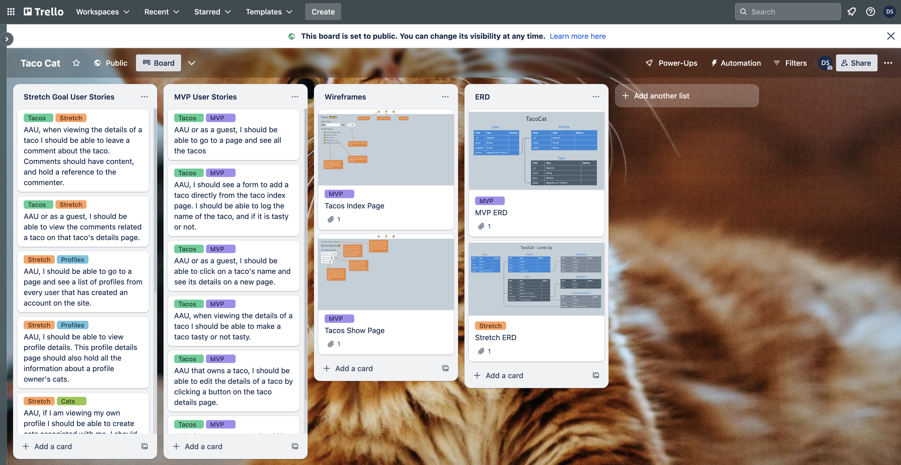

<h1>
  <span class="prefix"></span>
  <span class="headline">React App Project</span>
  <span class="subhead">Project Deliverables</span>
</h1>
## Contents

**Deliverable details**:

- Project planning deliverable
- GitHub repo deliverables
- (Optional) Deployed app link deliverable

**Submitting deliverables**:

- Submitting your deliverables

## Project planning deliverable

Planning is vital to build anything more than the most trivial of applications; therefore, this is where your group will begin its journey with this project. You shouldn't write any code or set up a GitHub repo for your project until an instructor approves your planning materials.

### Building your planning materials

Use a public board (e.g. [Trello](https://trello.com/)) for your project planning work.

If you are using Trello, this [video](https://www.youtube.com/watch?v=l3F3l3psqXY) has some helpful tips to get started using Trello if you've never used it before. Check out this [Trello support article](https://support.atlassian.com/trello/docs/changing-the-visibility-of-a-board/) to make your planning materials publicly available.

> 🚨 **_It is vital that you make your project planning publicly accessible; otherwise, no one can see it! Check out this if you are using Trello [Trello support article](https://support.atlassian.com/trello/docs/changing-the-visibility-of-a-board/) to learn how!_**

### Details

You will submit a public board (e.g. Trello) with these project planning details:

- MVP user stories, written in the following template: **As a \[user role\], I want \[feature\], so that \[reason\].** If the reason is obvious, it can be excluded.
- Wireframes for your app's main pages. For example, if you were building a blogging app, you might have wireframes for a landing page, the posts index page, and the add post page.

To organise this information, set up the public board for your project with the following **lists**:

- **MVP User Stories**: To hold your MVP user stories. Each user story should be an individual card in the list.
- **Wireframes**: To hold the wireframes for your app. Each wireframe should be an individual card on the list. You may also want to include Wireframes built with your stretch goals in mind. If you do this, ensure that these cards are clearly labeled.

During planning, you may want to include additional user stories that describe stretch goal features that go beyond the project requirements. Ensure these are in a separate list called **Stretch Goal User Stories** on your Trello board.

An example of an acceptable Trello board submission is shown here:



### Using Trello during project week

Some users like to use Trello during project week to keep track of their work. While you're more than welcome to do this, it is not a project requirement, and the method you use to organize your work is ultimately up to you!

## GitHub repo deliverables

After your project proposal has been approved, your team will need to designate someone to set up the two main GitHub repos for your project - one for the front-end and another for the back-end.

> 🚨 As a reminder, you should use the same front-end and back-end repos or keep all the repos you use for the entire duration of your project to meet the project requirements.

## (Optional) Deployed app link deliverable

During project week, your team will deploy the project so that others are able to use it on the internet! The back-end and front-end applications will be deployed separately.

## Submitting your deliverables

Follow the guidelines below to submit your team's deliverables for this project.

### Submitting your planning materials

You will submit a single link to your **_publicly visible_** Trello board below in the following format:

```plaintext
Project planning link: <link>
```

Replacing `<link>` (including the `<` and `>`) with a link to your project planning materials.

### Submitting your GitHub repo links

Submit a link to the public GitHub repo that you are using for your React App Project below in the following format::

```plaintext
GitHub repo link: <link>
```

Replacing `<link>` (including the `<` and `>`) with a link to your GitHub repo.

### (Optional) Submitting your deployed app link

Deploy your project by following the guides above. You will submit a single link to your deployed front-end app below in the following format:

```plaintext
Deployed project link: <link>
```

Replacing `<link>` (including the `<` and `>`) with a link to your deployed front-end app.
